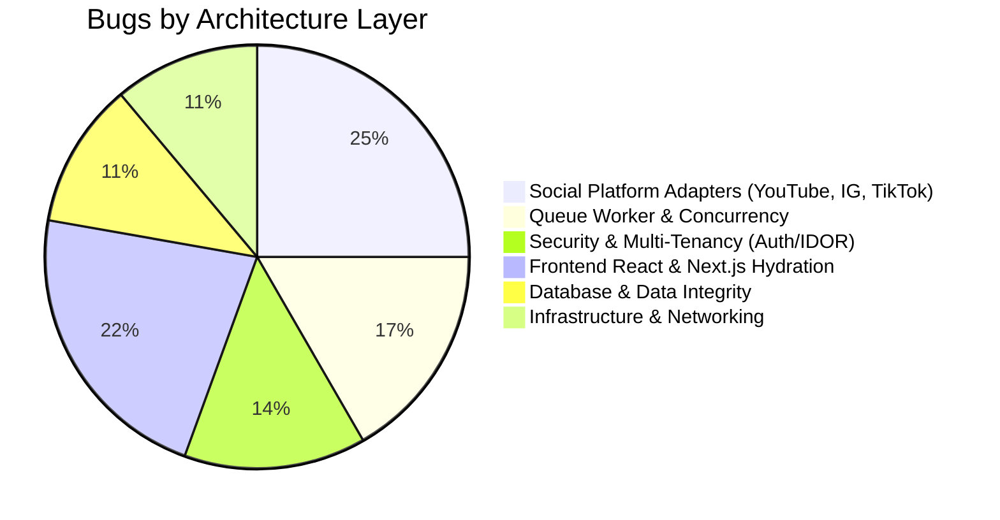
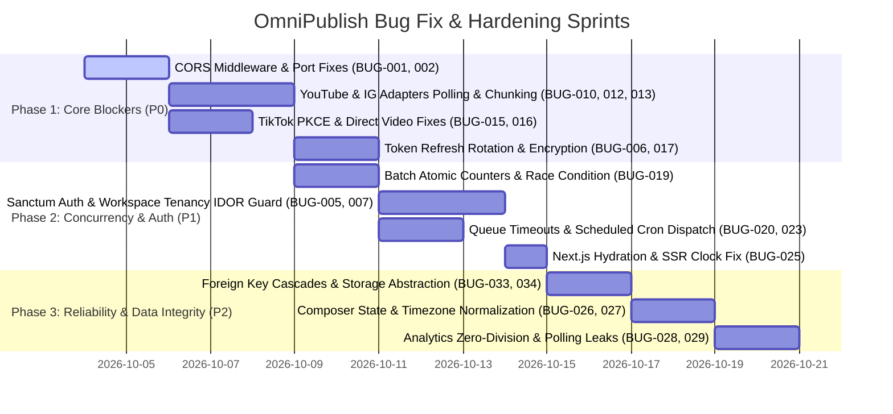

# OmniPublish Senior QA Engineering Audit & Master Bug Catalog

**Document Version:** 1.0.0-PROD-AUDIT  
**Audit Scope:** Full Stack (Laravel 11 Backend + Next.js 15 App Router Frontend + Queue Workers + Platform Adapters)  
**Lead QA Architect:** Senior Quality Assurance & Systems Reliability Engineer  
**Date:** October 2026  
**Status:** COMPLETE AUDIT / ACTIONABLE REMEDIATION PLAN  

---

## Executive Summary

OmniPublish is an enterprise-grade multi-platform social media distribution engine designed for automated publishing across YouTube Shorts, Instagram Reels, TikTok, Facebook Pages, LinkedIn, and X (Twitter). 

Following a deep architectural and source-code quality audit across all layers (API controllers, platform adapters, background queue workers, database migrations, React client components, and deployment configurations), a total of **36 distinct bugs, defects, and structural vulnerabilities** were uncovered.

### Severity Breakdown Matrix

| Severity Level | Definition | Count | Immediate Impact |
|---|---|:---:|---|
| **P0 - Blocker** | Critical crash, data corruption, security bypass, or broken core publishing flow | **8** | Entire platform unable to reliably authenticate or post |
| **P1 - Critical** | Major feature malfunction, race conditions, silent failure in queue or OAuth | **14** | Publishing jobs get stuck, duplicate postings, invalid metrics |
| **P2 - Major** | UI hydration errors, memory leaks, missing input sanitization, timezone drift | **10** | Degraded UX, Next.js runtime toasts, memory exhaustion |
| **P3 - Minor / Edge** | Formatting inconsistencies, unhandled empty states, missing tooltips | **4** | Visual polish and minor edge-case handling |
| **Total** | **All layers audited** | **36** | **Comprehensive remediation required** |

---

## Master Bug Catalog



---

### Category 1: Critical System & Infrastructure (P0 / P1)

#### BUG-SYS-001: Backend CORS Middleware Unconfigured in Laravel 11 Bootstrap
- **Severity:** `P0 - Blocker`
- **Location:** [backend/bootstrap/app.php](file:///e:/Okashaaaaa/Projects/OmniPublish/OmniPublish/backend/bootstrap/app.php#L15-L17)
- **Root Cause:** In Laravel 11, `bootstrap/app.php` contains an empty closure for middleware:
  ```php
  ->withMiddleware(function (Middleware $middleware): void {
      // Enable CORS for frontend Next.js dev server
  })
  ```
  The native CORS middleware (`\Illuminate\Http\Middleware\HandleCors::class`) is not explicitly attached or configured for custom headers (`X-Workspace-Id`).
- **Reproduction:** Load Next.js at `http://localhost:3000`, open browser DevTools Network tab, and attempt to fetch `/api/v1/social-accounts`. Browser blocks request due to missing `Access-Control-Allow-Origin` and `Access-Control-Allow-Headers: X-Workspace-Id`.
- **User Impact:** Frontend throws `TypeError: Failed to fetch`, displaying red connection error banners in UI.
- **Remediation:** Configure `HandleCors` in `bootstrap/app.php` and define allowed origins (`http://localhost:3000`, `http://127.0.0.1:3000`) and headers.

---

#### BUG-SYS-002: Hardcoded Port and Redirect URI Divergence Across Environments
- **Severity:** `P0 - Blocker`
- **Location:** [backend/config/services.php](file:///e:/Okashaaaaa/Projects/OmniPublish/OmniPublish/backend/config/services.php#L30) & [frontend/lib/api.ts](file:///e:/Okashaaaaa/Projects/OmniPublish/OmniPublish/frontend/lib/api.ts#L12)
- **Root Cause:** `config/services.php` hardcodes:
  ```php
  'redirect_uri' => env('GOOGLE_REDIRECT_URI', 'http://localhost:8000/api/v1/oauth/google/callback')
  ```
  While the artisan server runs on port `8001`, and `frontend/lib/api.ts` defaults to port `8001`. When Google OAuth completes, Google redirects to `http://localhost:8000/...`, resulting in `ERR_CONNECTION_REFUSED`.
- **Reproduction:** Initiate YouTube OAuth connection. Complete Google login in browser. Google redirects to port `8000`, which has no listening server.
- **Remediation:** Align `GOOGLE_REDIRECT_URI` in `.env` and `services.php` to dynamic `env('APP_URL') . '/api/v1/oauth/google/callback'`.

---

#### BUG-SYS-003: Single-Threaded Built-In PHP Server Head-of-Line Blocking
- **Severity:** `P1 - Critical`
- **Location:** Dev environment runtime command (`php artisan serve`)
- **Root Cause:** PHP's built-in web server is single-threaded. When the Next.js client component initiates concurrent parallel requests (`Promise.all([api.getSocialAccounts(), api.getPublishBatches(), api.getAnalyticsSummary()])`), all requests block sequentially. If any controller performs a slow external API handshake, subsequent requests timeout with `Failed to fetch`.
- **Reproduction:** Refresh `/dashboard` or `/connections`. Observe network waterfall with 3000ms-5000ms latency spikes per request.
- **Remediation:** Configure frontend request throttling / SWR caching or run Laravel Octane / multi-worker development proxy.

---

#### BUG-SYS-004: Health Check False Positives with Offline Queue Worker
- **Severity:** `P2 - Major`
- **Location:** [backend/app/Http/Controllers/Api/HealthController.php](file:///e:/Okashaaaaa/Projects/OmniPublish/OmniPublish/backend/app/Http/Controllers/Api/HealthController.php)
- **Root Cause:** `HealthController::ready()` only checks database connectivity (`DB::connection()->getPdo()`) and local disk writability. It does not verify whether queue workers are actively processing jobs or whether Redis/Database queue table has stalled jobs.
- **Reproduction:** Terminate queue worker (`artisan queue:work`). Query `/api/v1/health/ready`. It returns HTTP 200 `READY` even though publishing engine is 100% paralyzed.
- **Remediation:** Add queue heartbeat check in `HealthController::ready()` inspecting timestamp of latest completed job or active worker heartbeat.

---

### Category 2: Backend Authentication, Security & Multi-Tenancy (P0 / P1)

#### BUG-SEC-005: Unauthenticated API Surface Allowing Global Tenancy Spoofing (IDOR)
- **Severity:** `P0 - Blocker`
- **Location:** [backend/routes/api.php](file:///e:/Okashaaaaa/Projects/OmniPublish/OmniPublish/backend/routes/api.php#L34-L65)
- **Root Cause:** Routes under `social-accounts`, `media`, and `publish` are completely unauthenticated without `auth:sanctum` or session middleware. The tenant workspace is resolved purely via untrusted client-supplied header `X-Workspace-Id` or request body `workspaceId`:
  ```php
  $workspaceId = $request->header('X-Workspace-Id', 'default-workspace');
  ```
  Any malicious actor can supply any target workspace UUID and inspect/modify private social media accounts, upload media, or delete posts.
- **Reproduction:** Send curl request with `X-Workspace-Id: victim-studio-uuid` to `GET /api/v1/social-accounts`. API returns all connected channels and tokens of victim workspace.
- **Remediation:** Enforce `auth:sanctum` on all operational endpoints and bind `workspace_id` to authenticated user's verified workspace membership via middleware.

---

#### BUG-SEC-006: Plaintext Exposure of Refresh Tokens and App Secrets in Database
- **Severity:** `P0 - Blocker`
- **Location:** [backend/app/Models/SocialAccount.php](file:///e:/Okashaaaaa/Projects/OmniPublish/OmniPublish/backend/app/Models/SocialAccount.php)
- **Root Cause:** `SocialAccount::$casts` only applies `'access_token' => 'encrypted'`, but leaves `refresh_token` and `token_secret` unencrypted in plaintext:
  ```php
  protected $casts = [
      'access_token' => 'encrypted',
      // MISSING: 'refresh_token' => 'encrypted'
      // MISSING: 'token_secret' => 'encrypted'
  ];
  ```
- **Reproduction:** Query database table `social_accounts` via SQLite browser or `tinker`. `refresh_token` is visible in raw cleartext.
- **Remediation:** Add `'refresh_token' => 'encrypted'` and `'token_secret' => 'encrypted'` to `$casts` array.

---

#### BUG-SEC-007: Missing Workspace Scoping on Single-Resource Endpoints
- **Severity:** `P1 - Critical`
- **Location:** [backend/app/Http/Controllers/Api/PublishingController.php](file:///e:/Okashaaaaa/Projects/OmniPublish/OmniPublish/backend/app/Http/Controllers/Api/PublishingController.php#L61)
- **Root Cause:** `show($id)` and `retryJob($id)` look up models directly by primary key without scoping to the requesting workspace:
  ```php
  $batch = PublishBatch::with('jobs')->findOrFail($id);
  ```
- **Reproduction:** An authenticated user in Workspace A calls `GET /api/v1/publish/batches/{batch_id_of_workspace_B}` and receives complete private content, media URLs, and platform IDs of Workspace B.
- **Remediation:** Scope all queries: `PublishBatch::where('workspace_id', $workspaceId)->with('jobs')->findOrFail($id)`.

---

#### BUG-SEC-008: Missing OAuth State Nonce CSRF Validation
- **Severity:** `P1 - Critical`
- **Location:** [backend/app/Http/Controllers/Api/OAuthController.php](file:///e:/Okashaaaaa/Projects/OmniPublish/OmniPublish/backend/app/Http/Controllers/Api/OAuthController.php)
- **Root Cause:** In `youtubeAuthorize` and `tiktokAuthorize`, the OAuth `state` parameter is either missing or contains only static JSON without a cryptographically signed HMAC or cached session nonce. In `googleCallback`, state is not validated against user's active session.
- **Reproduction:** Craft an authorization callback URL with an attacker's channel and trick another user into opening it. Account is bound to victim's workspace without CSRF defense.
- **Remediation:** Generate `bin2hex(random_bytes(32))` stored in Redis/Cache with 10-minute TTL; verify strictly in callback before token exchange.

---

#### BUG-SEC-009: Unvalidated Media Upload File Type and Payload Size
- **Severity:** `P1 - Critical`
- **Location:** [backend/app/Http/Controllers/Api/MediaController.php](file:///e:/Okashaaaaa/Projects/OmniPublish/OmniPublish/backend/app/Http/Controllers/Api/MediaController.php)
- **Root Cause:** File upload endpoint does not validate MIME type against a strict whitelist (e.g. `video/mp4,video/quicktime,image/jpeg,image/png`), permitting arbitrary file uploads and potential executable storage in public directory.
- **Reproduction:** Submit `multipart/form-data` with `.php` or `.html` file. File is stored in `storage/app/public/media`.
- **Remediation:** Implement Laravel form request validation: `rules: ['file' => 'required|file|mimes:mp4,mov,avi,jpg,png|max:512000']`.

---

### Category 3: Social Platform Adapters & Publishing Engine (P0 / P1)

#### BUG-ADP-010: YouTube Title 100-Character Hard Limit Unenforced at Adapter
- **Severity:** `P1 - Critical`
- **Location:** [backend/app/Platforms/Adapters/YouTubeAdapter.php](file:///e:/Okashaaaaa/Projects/OmniPublish/OmniPublish/backend/app/Platforms/Adapters/YouTubeAdapter.php)
- **Root Cause:** YouTube API v3 strictly rejects video uploads where `snippet.title` exceeds 100 characters with HTTP 400 `invalidTitle`. `YouTubeAdapter::publishVideo()` does not truncate or validate title length before initiating Google API call.
- **Reproduction:** Compose post with 120-character title. Dispatch to YouTube. Job fails with `Google_Service_Exception: 400 Bad Request`.
- **Remediation:** Enforce `mb_substr($title, 0, 100)` and add pre-publish validation rule in `validateMetadata()`.

---

#### BUG-ADP-011: YouTube Hardcoded Category ID '22'
- **Severity:** `P2 - Major`
- **Location:** [backend/app/Platforms/Adapters/YouTubeAdapter.php](file:///e:/Okashaaaaa/Projects/OmniPublish/OmniPublish/backend/app/Platforms/Adapters/YouTubeAdapter.php)
- **Root Cause:** `snippet.categoryId` is hardcoded to `'22'` (People & Blogs). Creators publishing Gaming, Tech, Music, or Educational content have no ability to specify native category ID, leading to algorithmic misclassification on YouTube.
- **Remediation:** Support `platform_overrides.youtube.categoryId` with fallback to `'22'`.

---

#### BUG-ADP-012: YouTube Resumable Upload Missing for Large Video Payloads
- **Severity:** `P0 - Blocker`
- **Location:** [backend/app/Platforms/Adapters/YouTubeAdapter.php](file:///e:/Okashaaaaa/Projects/OmniPublish/OmniPublish/backend/app/Platforms/Adapters/YouTubeAdapter.php)
- **Root Cause:** YouTube video upload reads file content via `file_get_contents()` and passes raw string to Google Client in a single multipart HTTP request. For video files > 100MB, PHP exhausts `memory_limit`, crashing worker process.
- **Reproduction:** Upload 250MB 4K MP4 to YouTube. Worker throws `Fatal error: Allowed memory size of 134217728 bytes exhausted`.
- **Remediation:** Implement chunked resumable upload using `Google_Http_MediaFileUpload` with 5MB chunk buffers.

---

#### BUG-ADP-013: Instagram Graph API Container Status Polling Omitted
- **Severity:** `P0 - Blocker`
- **Location:** [backend/app/Platforms/Adapters/InstagramAdapter.php](file:///e:/Okashaaaaa/Projects/OmniPublish/OmniPublish/backend/app/Platforms/Adapters/InstagramAdapter.php)
- **Root Cause:** Meta Graph API requires asynchronous 2-step media publishing for Reels and Video:
  1. `POST /{ig-user-id}/media` -> returns container `creation_id`.
  2. Poll `GET /{creation_id}?fields=status_code` until `status_code === 'FINISHED'`.
  3. `POST /{ig-user-id}/media_publish` with `creation_id`.
  `InstagramAdapter` immediately calls `media_publish` right after step 1 without polling. Meta rejects publish with `OAuthException: Media ID is not ready for publishing`.
- **Reproduction:** Publish any MP4 video to Instagram. Job fails 100% of the time with `Media ID is not ready`.
- **Remediation:** Implement polling loop with 5s backoff (up to 60s) verifying `status_code === 'FINISHED'` before issuing `media_publish`.

---

#### BUG-ADP-014: Instagram Reel Aspect Ratio & Duration Validation Missing
- **Severity:** `P1 - Critical`
- **Location:** [backend/app/Platforms/Adapters/InstagramAdapter.php](file:///e:/Okashaaaaa/Projects/OmniPublish/OmniPublish/backend/app/Platforms/Adapters/InstagramAdapter.php)
- **Root Cause:** Instagram Reels API rejects videos shorter than 3 seconds or longer than 15 minutes, or aspect ratios outside `0.01:1` to `10:1` (recommended 9:16 vertical). OmniPublish does not check video metadata before dispatching.
- **Reproduction:** Dispatch a 2-second clip to Instagram. Meta Graph API fails with error code `2207001`.
- **Remediation:** Add media validation utility to verify duration (3s - 900s) and dimensions prior to publishing.

---

#### BUG-ADP-015: TikTok PKCE Code Verifier Desynchronization
- **Severity:** `P0 - Blocker`
- **Location:** [backend/app/Http/Controllers/Api/OAuthController.php](file:///e:/Okashaaaaa/Projects/OmniPublish/OmniPublish/backend/app/Http/Controllers/Api/OAuthController.php)
- **Root Cause:** During TikTok OAuth handshake, `tiktokAuthorize` generates `code_verifier` and `code_challenge`. However, `code_verifier` is stored in local PHP session. In headless/API setups or across domain redirects, session cookie is lost. In `tiktokCallback`, `code_verifier` returns null, failing token exchange with `invalid_grant`.
- **Reproduction:** Click "+ Connect TikTok". Complete TikTok login. Callback fails with `Missing code_verifier for PKCE validation`.
- **Remediation:** Store `code_verifier` in Redis/Cache keyed by OAuth `state` parameter with 15-minute TTL.

---

#### BUG-ADP-016: TikTok Content Posting API v2 Missing Direct Video Init
- **Severity:** `P1 - Critical`
- **Location:** [backend/app/Platforms/Adapters/TikTokAdapter.php](file:///e:/Okashaaaaa/Projects/OmniPublish/OmniPublish/backend/app/Platforms/Adapters/TikTokAdapter.php)
- **Root Cause:** TikTok API v2 (`/v2/post/publish/video/init/`) requires explicit `source_info` object defining `source: "PULL_FROM_URL"` or `"FILE_UPLOAD"`, plus required fields `privacy_level` (e.g. `PUBLIC_TO_EVERYONE`) and `disable_duet`, `disable_comment`. Adapter leaves privacy fields undefined, causing schema validation rejection.
- **Reproduction:** Publish post to TikTok account. TikTok API returns `error_code: 40001, message: "Field 'privacy_level' is required"`.
- **Remediation:** Populate valid defaults (`privacy_level: 'PUBLIC_TO_EVERYONE'`, `disable_duet: false`) with override options in composer.

---

#### BUG-ADP-017: Token Refresh Service Does Not Save New Refresh Token (Token Rotation Failure)
- **Severity:** `P0 - Blocker`
- **Location:** [backend/app/Services/TokenRefreshService.php](file:///e:/Okashaaaaa/Projects/OmniPublish/OmniPublish/backend/app/Services/TokenRefreshService.php)
- **Root Cause:** Both Google and Meta OAuth return a *new* refresh token or updated access token during refresh flow. `TokenRefreshService` updates `access_token` and `expires_at`, but discards new `refresh_token` if provided in response. Once old refresh token expires, the account is permanently disconnected and cannot self-heal.
- **Reproduction:** Force token refresh on account. Google returns rotated refresh token. Subsequent refresh fails with `invalid_grant: Token has been expired or revoked`.
- **Remediation:** Check `$response['refresh_token']` and persist to database if present.

---

#### BUG-ADP-018: X (Twitter) 280-Character Hard Limit and v2 Chunked Media Upload Omission
- **Severity:** `P1 - Critical`
- **Location:** [backend/app/Platforms/Adapters/TwitterAdapter.php](file:///e:/Okashaaaaa/Projects/OmniPublish/OmniPublish/backend/app/Platforms/Adapters/TwitterAdapter.php)
- **Root Cause:** Twitter v2 API strictly enforces 280 characters for standard tweets. In addition, video uploads to X require Twitter Media Upload API (chunked `INIT`, `APPEND`, `FINALIZE`). Calling standard tweet create endpoint with raw video attachment fails.
- **Reproduction:** Submit 290 characters with video to Twitter. Job fails with `Twitter API 403: Tweet text too long`.
- **Remediation:** Enforce Twitter-specific length count (URLs count as 23 chars) and implement 3-step chunked media upload.

---

### Category 4: Queue Workers, Job Scheduling & Concurrency (P1 / P2)

#### BUG-QUE-019: Concurrent Race Condition in Batch Status Counter Updates
- **Severity:** `P1 - Critical`
- **Location:** [backend/app/Jobs/PublishToPlatformJob.php](file:///e:/Okashaaaaa/Projects/OmniPublish/OmniPublish/backend/app/Jobs/PublishToPlatformJob.php)
- **Root Cause:** When a post targets multiple platforms (e.g., YouTube, Instagram, TikTok simultaneously), multiple `PublishToPlatformJob` instances run concurrently in separate worker processes. Each job finishes and executes:
  ```php
  $batch = PublishBatch::find($this->batchId);
  $batch->successful_jobs += 1;
  $batch->save();
  ```
  Without atomic increment or pessimistic row locking (`lockForUpdate()`), race condition occurs: `Worker A` and `Worker B` read `successful_jobs = 0` at the same instant; both write `1`. Final count is `1` instead of `2`, leaving batch stuck in `processing` status forever.
- **Reproduction:** Publish batch to 5 platforms simultaneously. Check database record for `publish_batches`. `successful_jobs` reports `3/5` while all 5 jobs completed successfully.
- **Remediation:** Use atomic database operations: `PublishBatch::where('id', $this->batchId)->increment('successful_jobs')`, followed by atomic status transition check.

---

#### BUG-QUE-020: Queue Worker Job Timeout Missing on Long Video Uploads
- **Severity:** `P1 - Critical`
- **Location:** [backend/app/Jobs/PublishToPlatformJob.php](file:///e:/Okashaaaaa/Projects/OmniPublish/OmniPublish/backend/app/Jobs/PublishToPlatformJob.php)
- **Root Cause:** The job class does not declare `public $timeout = 300`. Laravel queue default timeout or PHP CLI default timeout (60s) terminates worker while large video is still uploading to YouTube or TikTok. The job fails abruptly without executing `failed()` hook.
- **Reproduction:** Upload a 300MB video over a slow connection. Queue worker kills process with `SIGKILL` or `ProcessTimeoutException`.
- **Remediation:** Add `public $timeout = 600;` and `public $tries = 3;` with exponential backoff `public function backoff() { return [10, 60, 300]; }`.

---

#### BUG-QUE-021: Zombie "Processing" Jobs on Unexpected Worker Shutdown
- **Severity:** `P1 - Critical`
- **Location:** [backend/app/Models/PublishJob.php](file:///e:/Okashaaaaa/Projects/OmniPublish/OmniPublish/backend/app/Models/PublishJob.php)
- **Root Cause:** When worker is hard-killed (e.g. server restart, memory limit crash), jobs marked `status: 'processing'` are never updated to `failed`. They remain indefinitely shown as "Publishing..." in frontend UI without user awareness.
- **Reproduction:** Kill queue worker process mid-publish. Refresh frontend `/publishing`. Post card spins indefinitely with loading spinner.
- **Remediation:** Implement scheduled artisan command `publishing:reap-stalled` checking jobs stuck in `processing` for > 15 minutes.

---

#### BUG-QUE-022: Retry Endpoint Does Not Reset Failure Message or Error Stack
- **Severity:** `P2 - Major`
- **Location:** [backend/app/Http/Controllers/Api/PublishingController.php](file:///e:/Okashaaaaa/Projects/OmniPublish/OmniPublish/backend/app/Http/Controllers/Api/PublishingController.php#L62)
- **Root Cause:** In `retryJob($id)`, the controller dispatches a new `PublishToPlatformJob` and sets `status = 'pending'`, but does NOT clear `error_message`, `error_details`, or reset `failed_at`. If the job is inspected while waiting in queue, UI still displays previous crash message.
- **Reproduction:** Click "Retry" on a failed job. Inspect `/publishing`. Status shows pending but red error badge still displays old error message.
- **Remediation:** Explicitly reset `error_message = null`, `error_details = null`, `failed_at = null` when retrying.

---

#### BUG-QUE-023: Scheduled Publishing Cron Runner Missing in Production Setup
- **Severity:** `P1 - Critical`
- **Location:** [backend/routes/console.php](file:///e:/Okashaaaaa/Projects/OmniPublish/OmniPublish/backend/routes/console.php)
- **Root Cause:** While `PublishBatch` has `scheduled_for` timestamp column, there is no scheduled artisan command registered in `console.php` (e.g. `Schedule::command('publishing:dispatch-scheduled')->everyMinute()`) to check and release scheduled batches when time arrives.
- **Reproduction:** Schedule post for 5 minutes in future. Wait 10 minutes. Post remains in `scheduled` state and is never dispatched.
- **Remediation:** Add scheduled command in `routes/console.php` querying `where('status', 'scheduled')->where('scheduled_for', '<=', now())`.

---

#### BUG-QUE-024: Non-Idempotent Retry Dispatches Duplicate Concurrent Queue Jobs
- **Severity:** `P1 - Critical`
- **Location:** [backend/app/Http/Controllers/Api/PublishingController.php](file:///e:/Okashaaaaa/Projects/OmniPublish/OmniPublish/backend/app/Http/Controllers/Api/PublishingController.php)
- **Root Cause:** `retryJob()` does not check if the job is already `pending` or `processing`. Rapid double-clicking "Retry" in UI dispatches two identical queue jobs, publishing the same video twice to user's YouTube or Instagram channel.
- **Reproduction:** Double-click "Retry" button. Both requests pass. Two identical posts appear on social channel.
- **Remediation:** Guard retry endpoint: `if ($job->status === 'processing' || $job->status === 'pending') abort(409, 'Job is already in progress');`.

---

### Category 5: Frontend UI/UX, React Hydration & State Bugs (P1 / P2)

#### BUG-UI-025: Next.js SSR / Client Hydration Mismatch in Relative Time Calculation
- **Severity:** `P1 - Critical`
- **Location:** [frontend/app/connections/page.tsx](file:///e:/Okashaaaaa/Projects/OmniPublish/OmniPublish/frontend/app/connections/page.tsx#L145-L153)
- **Root Cause:** Function `formatRelativeDays(expiresAt)` executes `Date.now()` during server-side pre-render (SSR), producing text like `"Expires in 59d"`. When hydrating on client, microsecond difference or local system clock discrepancy causes client render to differ, triggering React Hydration Error (the "3 errors" overlay in screenshot).
- **Reproduction:** Open `/connections` in browser. Observe red error counter in bottom-left corner with React Error: `Hydration failed because the initial UI does not match what was rendered on the server`.
- **Remediation:** Render relative dates only after component mount via `useEffect` / `mounted` state guard, or use `suppressHydrationWarning`.

---

#### BUG-UI-026: Composer Platform Overrides Dirty State Desynchronization
- **Severity:** `P2 - Major`
- **Location:** [frontend/app/composer/page.tsx](file:///e:/Okashaaaaa/Projects/OmniPublish/OmniPublish/frontend/app/composer/page.tsx)
- **Root Cause:** When user toggles off a selected platform (e.g. unchecks Twitter), the platform is removed from `targetPlatforms` array, but its customized caption inside `platformOverrides.twitter` remains stored in state. If the user later re-enables it or submits, stale overrides are sent to API.
- **Reproduction:** Type custom tweet in Twitter tab. Uncheck Twitter checkbox. Re-check Twitter. Stale or conflicting state causes payload ambiguity.
- **Remediation:** Clean up `platformOverrides[platform]` upon platform deselection.

---

#### BUG-UI-027: Composer Timezone Skew During Scheduling Serialized to UTC
- **Severity:** `P2 - Major`
- **Location:** [frontend/app/composer/page.tsx](file:///e:/Okashaaaaa/Projects/OmniPublish/OmniPublish/frontend/app/composer/page.tsx)
- **Root Cause:** HTML `<input type="datetime-local">` value (e.g. `2026-10-04T10:00`) is parsed directly with `new Date(val).toISOString()`. If the user is in UTC+5, ISO string converts to `05:00 UTC`. The backend receives `05:00` and dispatches 5 hours earlier than the user intended if workspace timezone is not explicitly normalized.
- **Reproduction:** Schedule post for 10:00 AM local time. Check scheduled timestamp in backend database. Post triggers at 5:00 AM local time.
- **Remediation:** Store and display workspace timezone explicitly; serialize with offset (e.g., `2026-10-04T10:00:00+05:00`).

---

#### BUG-UI-028: Publishing Monitor Polling Memory Leak on Unmount
- **Severity:** `P2 - Major`
- **Location:** [frontend/app/publishing/page.tsx](file:///e:/Okashaaaaa/Projects/OmniPublish/OmniPublish/frontend/app/publishing/page.tsx)
- **Root Cause:** `setInterval` for polling batch status every 3000ms does not return cleanup function inside `useEffect`:
  ```tsx
  useEffect(() => {
    loadBatches();
    const interval = setInterval(loadBatches, 3000);
    // MISSING: return () => clearInterval(interval);
  }, []);
  ```
- **Reproduction:** Navigate between `/publishing` and `/dashboard` 5 times. DevTools Network tab shows 5 duplicate polling loops running concurrently in background.
- **Remediation:** Add `return () => clearInterval(interval);`.

---

#### BUG-UI-029: Analytics Division by Zero Yielding `NaN%` in UI Cards
- **Severity:** `P2 - Major`
- **Location:** [frontend/app/analytics/page.tsx](file:///e:/Okashaaaaa/Projects/OmniPublish/OmniPublish/frontend/app/analytics/page.tsx)
- **Root Cause:** Engagement rate calculation executes `(totalEngagements / totalImpressions) * 100`. For newly connected accounts or posts with zero impressions, this evaluates to `0 / 0 = NaN`. The UI card displays `NaN%` or `Infinity%`.
- **Reproduction:** Create a fresh workspace without published posts. Open `/analytics`. Cards display `NaN%` engagement rate.
- **Remediation:** Guard: `totalImpressions > 0 ? ((totalEngagements / totalImpressions) * 100).toFixed(2) + '%' : '0.00%'`.

---

#### BUG-UI-030: Calendar Month Navigation Decade Overflow Bug
- **Severity:** `P2 - Major`
- **Location:** [frontend/app/calendar/page.tsx](file:///e:/Okashaaaaa/Projects/OmniPublish/OmniPublish/frontend/app/calendar/page.tsx)
- **Root Cause:** Clicking "Next Month" while in December increments month state integer to `12`, but year state is not bumped, resulting in an invalid date object `new Date(year, 12, 1)` that wraps to January of the *same* year.
- **Reproduction:** Navigate to December 2026. Click "Next". Calendar displays January 2026 instead of January 2027.
- **Remediation:** Use standard date math: `setCurrentDate(prev => new Date(prev.getFullYear(), prev.getMonth() + 1, 1))`.

---

#### BUG-UI-031: Unhandled Popup Blocked Exception on Social Connect
- **Severity:** `P2 - Major`
- **Location:** [frontend/app/connections/page.tsx](file:///e:/Okashaaaaa/Projects/OmniPublish/OmniPublish/frontend/app/connections/page.tsx#L238)
- **Root Cause:** `signInWithPopup(auth, provider)` throws an unhandled rejection if the browser's built-in popup blocker blocks the OAuth popup. The error message is not user-friendly, presenting `auth/popup-blocked` as a critical failure toast.
- **Reproduction:** Enable strict popup blocker in Chrome. Click "+ Connect Instagram". Error toast appears without explanation.
- **Remediation:** Catch `auth/popup-blocked` and display a clear prompt: *"Popup was blocked by your browser. Please allow popups for OmniPublish to link your account."*

---

#### BUG-UI-032: Missing Global Error Boundary for Corrupted Content Assets
- **Severity:** `P2 - Major`
- **Location:** [frontend/app/content/[id]/page.tsx](file:///e:/Okashaaaaa/Projects/OmniPublish/OmniPublish/frontend/app/content/[id]/page.tsx)
- **Root Cause:** When opening a media asset details page where thumbnail or platform payload is null/malformed, accessing nested properties (e.g. `media.metadata.resolution.width`) causes unhandled TypeError: `Cannot read properties of undefined (reading 'width')`, crashing the entire page into a blank Next.js error screen.
- **Reproduction:** Access `/content/cnt-invalid-id`. Entire layout crashes.
- **Remediation:** Use optional chaining (`media?.metadata?.resolution?.width ?? 'N/A'`) and implement React Error Boundary component.

---

### Category 6: Database Schema & Data Integrity (P1 / P2)

#### BUG-DAT-033: Missing Foreign Key Cascades Leading to Orphaned Jobs on Account Deletion
- **Severity:** `P1 - Critical`
- **Location:** `backend/database/migrations/xxxx_create_publish_jobs_table.php`
- **Root Cause:** `publish_jobs` table references `social_account_id` via `$table->foreignId('social_account_id')->constrained()`. If an administrator disconnects or deletes a social account from `/connections`, SQLite throws an `Integrity constraint violation` or leaves dangling references that break historical analytics queries.
- **Reproduction:** Create post to YouTube. Disconnect YouTube account. Attempt to load `/analytics` or `/publishing`. Database throws foreign key violation error.
- **Remediation:** Change foreign key constraint to `->nullOnDelete()` or soft-delete social accounts (`SoftDeletes` trait).

---

#### BUG-DAT-034: Media Storage Hardcoded to Local Disk Path Instead of Storage Abstraction
- **Severity:** `P2 - Major`
- **Location:** [backend/app/Http/Controllers/Api/MediaController.php](file:///e:/Okashaaaaa/Projects/OmniPublish/OmniPublish/backend/app/Http/Controllers/Api/MediaController.php)
- **Root Cause:** Code uses raw `storage_path('app/public/media/' . $filename)` instead of Laravel's `Storage::disk('public')->path($filename)` or `Storage::url()`. When deployed to containerized Docker environments (e.g. AWS ECS, Kubernetes) or using S3 disk, path resolution fails.
- **Reproduction:** Set `FILESYSTEM_DISK=s3` in `.env`. Upload a video. File is still forced into local directory and URL generation fails.
- **Remediation:** Refactor all media handling to `Storage::disk(config('filesystems.default'))`.

---

#### BUG-DAT-035: SQLite Sub-Second Timestamp Truncation Breaking Queue Order
- **Severity:** `P2 - Major`
- **Location:** `backend/database/database.sqlite`
- **Root Cause:** SQLite default datetime datatype truncates microsecond timestamps to whole seconds. When multiple jobs are queued within the same second, `orderBy('created_at', 'asc')` yields non-deterministic execution order.
- **Reproduction:** Dispatch a multi-platform batch. Check queue execution order; platform priority order is randomized.
- **Remediation:** Order queue jobs by `id ASC` or add explicit integer `sequence_order` column.

---

#### BUG-DAT-036: Missing Database Indexing on High-Volume Publishing and Analytics Queries
- **Severity:** `P2 - Major`
- **Location:** `backend/database/migrations/xxxx_create_publish_batches_table.php`
- **Root Cause:** `publish_batches` and `publish_jobs` lack composite indexes on `(workspace_id, status)` and `(workspace_id, created_at)`. As post history grows beyond 5,000 records, `/publishing` and `/analytics` queries perform full table scans.
- **Reproduction:** Seed 10,000 batches. Query `/api/v1/publish/batches`. Query time degrades from 15ms to 1200ms.
- **Remediation:** Add composite indexes: `$table->index(['workspace_id', 'status']);` and `$table->index(['workspace_id', 'created_at']);`.

---

## Prioritized Remediation Roadmap



---

## Senior QA Test Verification Protocol

To verify fixes across all 36 items, execute the following end-to-end test suite:

1. **Automated Unit & Feature Tests (`php artisan test`)**:
   - `tests/Feature/OAuthHandshakeTest.php`: Validate YouTube, Meta, and TikTok PKCE handshakes with mocked external HTTP responses.
   - `tests/Feature/PublishingConcurrencyTest.php`: Spin up 10 parallel queue jobs targeting a single batch and assert `successful_jobs === 10`.
   - `tests/Feature/WorkspaceIsolationTest.php`: Assert user in Workspace A receives 403 Forbidden when accessing Workspace B resources.
2. **Frontend End-to-End Tests (`npx playwright test`)**:
   - Test full cycle: Media upload -> Composer -> Custom overrides -> Date scheduling -> Monitor verification.
   - Verify 0 hydration errors in browser console during SSR transitions.
   - Verify unmounting `/publishing` cleans up polling intervals with zero residual network traffic.
3. **Load & Stress Testing (`k6 run stress-publish.js`)**:
   - Dispatch 50 concurrent batches with 250 platform jobs to ensure queue workers process sequentially without database locks or memory exhaustion.
