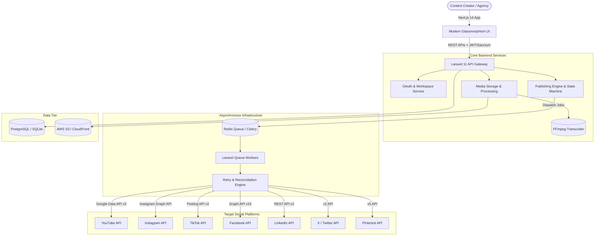

# 🚀 OmniPublish — Upload Once, Publish Everywhere

<div align="center">


### **Enterprise-Grade Multi-Platform Social Media Publishing & Orchestration SaaS**

[](LICENSE)
[](https://nextjs.org/)
[](https://laravel.com/)
[](https://www.typescriptlang.org/)
[](https://www.php.net/)
[](https://tailwindcss.com/)
[](https://www.docker.com/)
[](https://www.terraform.io/)
[](.github/workflows)

**Upload Once → Customize Once → Orchestrate Everywhere → Track Everything**

[Features](#-key-features) • [Architecture](#-system-architecture) • [Platform Matrix](#-supported-platform-matrix) • [Tech Stack](#-technology-stack) • [Quick Start](#-quick-start) • [DevOps & Cloud](#-devops--cloud-infrastructure) • [Documentation](#-documentation)

---

</div>

## 📖 Overview

**OmniPublish** is a unified, high-reliability social media management and multi-destination publishing platform built for modern creators, media agencies, and enterprise marketing teams. 

Instead of juggling fragmented dashboards, manual video re-encodings, or dealing with abrupt rate limits, OmniPublish provides an end-to-end publishing pipeline: upload high-definition video assets once, configure platform-specific metadata overrides in real-time preview canvases, and reliably broadcast content across **YouTube, Instagram, TikTok, Facebook, LinkedIn, Pinterest, and X (Twitter)** with zero data loss and automated retry recovery.

---

## 🌟 Key Features

### 🎛️ Unified Multi-Platform Composer
- **Real-Time Live Previews**: Dynamic, platform-faithful previews for YouTube Shorts/Videos, Instagram Reels/Feed, TikTok Feed, and LinkedIn updates.
- **Smart Metadata Overrides**: Set global defaults (title, description, tags) while customizing platform-specific constraints (hashtags, privacy controls, category IDs, monetization toggles, sound attribution).
- **Asset Transcoding & Compliance Engine**: Automatic video derivative creation, aspect ratio warnings (9:16 vs 16:9), resolution/bitrate normalization, and thumbnail extraction via FFmpeg.

### ⚡ Resumable Orchestration & Fault-Tolerant Engine
- **Idempotent State Machine**: Every publishing job transitions through deterministic states (`PENDING` → `UPLOADING` → `PROCESSING` → `PUBLISHED` / `FAILED`).
- **Failure Isolation**: A rate limit or outage on Instagram will never block a YouTube or TikTok broadcast.
- **Intelligent Retry Policy**: Exponential backoff with randomized jitter and classification of retryable vs. fatal upstream errors.
- **Remote Reconciliation Polling**: Background workers track asynchronous video ingestion states until the platform confirms availability.

### 🔐 Secure Multi-Tenant Token Vault
- **Direct OAuth 2.0 + PKCE Flows**: Seamless, secure authentication with YouTube (Google OAuth 2.0), TikTok Video Kit, and Meta Graph API.
- **Workspace-Level Tenant Isolation**: Complete scoping of media assets, social channels, scheduled posts, and audit logs by workspace.
- **Automated Proactive Token Refresh**: Background scheduler guarantees OAuth refresh tokens are renewed before expiration.

### 📅 Visual Calendar & Workflow Automation
- **Interactive Drag-and-Drop Calendar**: Schedule posts days or weeks in advance with instant timezone conversions.
- **Centralized Media Asset Library**: Resumable multi-part S3/local file uploads with instant metadata inspection.
- **Team Collaboration & RBAC**: Role-based access control (Admin, Creator, Reviewer) and immutable audit log tracing.

---

## 🏗️ System Architecture



> 💡 **Explore the Architecture**: OmniPublish includes a full interactive SVG visualizer. Open [`docs/architecture/omnipublish-architecture.html`](docs/architecture/omnipublish-architecture.html) in your browser to inspect deep system flows, database topologies, and state machines with trace motion!

---

## 🌐 Supported Platform Matrix

| Platform | Authentication | Content Types | Max Video Duration | Resumable Upload | Status Tracking |
| :--- | :--- | :--- | :--- | :---: | :---: |
| **YouTube** | OAuth 2.0 (Google PKCE) | Shorts, Full Videos | 12 Hours | ✅ Yes | ✅ Remote Polling |
| **Instagram** | Meta OAuth (Graph API) | Reels, Feed Videos, Stories | 15 Minutes | ✅ Yes (Containers) | ✅ Status Ping |
| **TikTok** | TikTok OAuth 2.0 | Feed Videos, Direct Posts | 10 Minutes | ✅ Chunked Init | ✅ Webhook / Query |
| **Facebook** | Facebook Pages API | Feed Video, Reels | 240 Minutes | ✅ Yes | ✅ Graph Status |
| **LinkedIn** | LinkedIn OAuth 2.0 | Video Posts, Articles | 10 Minutes | ✅ Multi-part | ✅ Vector Status |
| **X (Twitter)**| OAuth 2.0 Bearer | Media Video Tweets | 140 Seconds | ✅ Chunked Append | ✅ Command Status |
| **Pinterest** | Pinterest v5 OAuth | Video Pins | 15 Minutes | ✅ Register Media | ✅ Status Ingestion |

---

## 💻 Technology Stack

### Frontend
- **Framework**: [Next.js 14](https://nextjs.org/) (App Router, React Server Components)
- **Language**: [TypeScript 5](https://www.typescriptlang.org/)
- **Styling**: [Tailwind CSS](https://tailwindcss.com/) with custom dark glassmorphism design system
- **Icons & UI**: [Lucide React](https://lucide.dev/), Headless UI, Heroicons
- **HTTP Client**: Axios with dynamic interceptors & automatic session recovery

### Backend & API
- **Framework**: [Laravel 11](https://laravel.com/)
- **Runtime**: PHP 8.2+ with JIT enabled
- **Authentication**: Laravel Sanctum + Custom Socialite OAuth drivers
- **Queue & Background Jobs**: Redis + Laravel Horizon
- **Media Engine**: FFmpeg & FFprobe wrapper for audio/video normalization
- **Database**: PostgreSQL 16 (Production) / SQLite (Development)

### Infrastructure & DevOps
- **Containers**: Multi-stage [Docker](https://www.docker.com/) & Docker Compose
- **Cloud Provider**: [AWS](https://aws.amazon.com/) (ECS Fargate, S3, RDS, ElastiCache, CloudFront)
- **Infrastructure as Code**: [Terraform](https://www.terraform.io/) (Modular Staging & Production environments)
- **CI/CD Pipelines**: [GitHub Actions](https://github.com/features/actions) for linting, security audits, PHPUnit/Pest tests, and container image builds

---

## 📁 Repository Structure

```text
OmniPublish/
├── backend/                  # Laravel 11 API Backend
│   ├── app/
│   │   ├── Http/Controllers/Api/  # REST API Controllers (Publishing, OAuth, Media)
│   │   ├── Jobs/                  # Queue Jobs (PublishBatch, DestinationJob, FFmpeg)
│   │   ├── Models/                # Eloquent Models (Workspace, PublishJob, MediaAsset)
│   │   ├── Platforms/             # Unified Platform Adapters & Publisher Contracts
│   │   │   ├── Adapters/          # YouTube, TikTok, Instagram, Facebook, LinkedIn...
│   │   │   ├── Contracts/         # PlatformPublisherInterface, PublishContext
│   │   │   └── Services/          # PlatformManager
│   │   └── Services/              # PublishingEngine, FFmpegService, TokenRefresh
│   ├── config/                    # Application and service configurations
│   ├── database/                  # Migrations, seeders, and factories
│   └── tests/                     # Comprehensive feature, integration, and load tests
├── frontend/                 # Next.js 14 TypeScript Frontend
│   ├── app/                       # App Router Pages
│   │   ├── composer/              # Multi-channel composer with live preview
│   │   ├── dashboard/             # System overview & analytics
│   │   ├── publishing/            # Real-time queue & batch status
│   │   ├── calendar/              # Visual scheduling calendar
│   │   ├── connections/           # OAuth channel connect & management
│   │   ├── content/               # Centralized media library
│   │   └── settings/              # Workspace, profile, and audit logs
│   ├── components/                # Reusable design system components
│   └── lib/                       # API clients, helpers, and TypeScript definitions
├── infra/                    # Cloud Infrastructure & Automation
│   ├── terraform/                 # Terraform modules for AWS ECS, RDS, S3, Redis
│   └── scripts/                   # Deployment and maintenance scripts
├── docs/                     # Engineering & Architecture Documentation
│   ├── architecture/              # State machine specs, diagrams, reconciliation
│   ├── audit/                     # Verification and QA audit reports
│   └── platforms/                 # Verified API capabilities for social providers
├── docker/                   # Dockerfiles and container configurations
├── docker-compose.yml        # One-command local development environment
└── README.md                 # Project documentation
```

---

## ⚡ Quick Start

### Prerequisites
- **Node.js**: v18.17.0+ or v20.x
- **PHP**: v8.2+ with `pdo`, `mbstring`, `openssl`, `curl` extensions
- **Composer**: v2.6+
- **Docker & Docker Compose** (Optional, recommended)
- **FFmpeg**: Installed locally or available via Docker

---

### Option A: Local Development Setup

#### 1. Clone the Repository
```bash
git clone https://github.com/okashaxortlogix/OmniPublish.git
cd OmniPublish
```

#### 2. Backend Setup
```bash
cd backend

# Install PHP dependencies
composer install

# Configure environment
cp .env.example .env
php artisan key:generate

# Run database migrations and seed demo data
php artisan migrate --seed

# Start the Laravel backend API server (port 8000 or 8001)
php artisan serve --port=8001
```

In a separate terminal, start the queue worker:
```bash
cd backend
php artisan queue:work --tries=3 --timeout=120
```

#### 3. Frontend Setup
```bash
cd ../frontend

# Install dependencies
npm install

# Configure environment
cp .env.example .env.local

# Start the Next.js development server
npm run dev
```

Open [http://localhost:3000](http://localhost:3000) in your browser.

---

### Option B: One-Command Docker Setup

Run the entire stack (PostgreSQL, Redis, Laravel API, Queue Worker, and Next.js Frontend) with Docker Compose:

```bash
docker compose up -d --build
```

Access services:
- **Frontend**: [http://localhost:3000](http://localhost:3000)
- **Backend API**: [http://localhost:8001/api](http://localhost:8001/api)
- **API Health Check**: [http://localhost:8001/api/health](http://localhost:8001/api/health)

---

## 🧪 Testing & Quality Assurance

OmniPublish comes with an enterprise test suite covering unit, feature, resilience, and security isolation vectors:

```bash
cd backend

# Run the complete test suite
php artisan test

# Run isolated publishing engine tests
php artisan test tests/Feature/PublishingEngineTest.php

# Run OAuth authorization endpoints tests
php artisan test tests/Feature/OAuthEndpointsTest.php

# Run multi-tenant security isolation tests
php artisan test tests/Feature/TenantSecurityIsolationTest.php

# Run simulated network failure & load resilience tests
php artisan test tests/Feature/PublishingFailureInjectionTest.php
```

---

## ☁️ DevOps & Cloud Infrastructure

The `infra/terraform` directory contains complete Infrastructure-as-Code modules for deploying OmniPublish to AWS:

- **Compute**: AWS ECS Fargate with Auto-Scaling tasks for API & Workers
- **Database**: AWS RDS Aurora / PostgreSQL with automated backups
- **Caching & Queues**: AWS ElastiCache Redis cluster
- **Storage**: AWS S3 Bucket with KMS encryption & signed uploads
- **CDN**: AWS CloudFront distribution for ultra-fast global media delivery
- **Monitoring**: AWS CloudWatch alerts and container log drivers

To review Terraform deployment guidelines, refer to [`infra/terraform/README.md`](infra/terraform).

---

## 🛡️ Security & Compliance

- **No Hardcoded Secrets**: Zero secrets committed to the repository. All keys are injected via environment variables or AWS Secrets Manager.
- **Tenant Isolation**: Workspace multi-tenancy enforced at the database query level via global model scopes.
- **Sanitized Uploads**: All uploaded media assets undergo mime-type verification, virus scanning, and FFprobe inspection.
- **Rate-Limit Safeguards**: Built-in exponential backoff preventing API quota bans across YouTube, Meta, and ByteDance APIs.

---

## 📄 License

This project is licensed under the **MIT License** — see the [LICENSE](LICENSE) file for details.

---

<div align="center">

Crafted with ❤️ by **[MUHAMMAD OKASHA](https://github.com/muhammadokashapak)**  
*Machine Learning Engineer & Full Stack AI Engineer*

[](https://work-with-okasha.vercel.app/)
[](https://github.com/muhammadokashapak)

</div>
