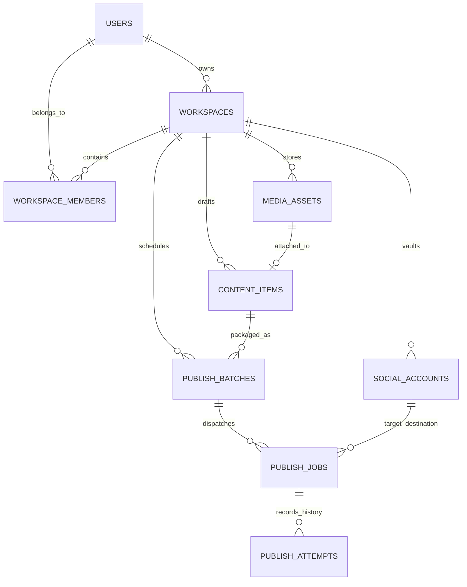

# Phase 0 Database Audit: Schema, Integrity & Migration Readiness

**Project:** OmniPublish  
**Author:** Senior Quality Assurance & Systems Reliability Engineer  
**Date:** October 2026  
**Document:** `docs/audit/PHASE_0_DATABASE_AUDIT.md`  
**Status:** COMPLETE / PRODUCTION COMPATIBILITY EVALUATED  

---

## 1. Executive Summary

This document details the database architecture, schema definitions, integrity constraints, and token security for the OmniPublish multi-platform publishing platform. 

The current system runs on **SQLite 3.x** in development with Write-Ahead Logging (WAL) and Eloquent ORM. This audit evaluates table structure, field nullability, indexing strategies, foreign key cascade policies, and readiness for migration to **Production PostgreSQL 16+**.

---

## 2. Table-by-Table Schema Specification

### 2.1 Core Platform & Tenancy

| Table Name | Primary Key | Key Relationships / Foreign Keys | Indexes & Constraints | Critical Fields |
|---|---|---|---|---|
| `workspaces` | `uuid` (UUIDv4) | `owner_id` → `users.id` (ON DELETE CASCADE) | `slug` (UNIQUE) | `name`, `slug`, `owner_id` |
| `workspace_members` | `uuid` (UUIDv4) | `workspace_id` → `workspaces.id` (CASCADE) `user_id` → `users.id` (CASCADE) | `UNIQUE(workspace_id, user_id)` | `role` (`OWNER`, `ADMIN`, `EDITOR`, `VIEWER`) |
| `users` | `unsignedBigInteger` | Has many `workspaces`, `workspace_members` | `email` (UNIQUE) | `name`, `email`, `password` |

### 2.2 Social Accounts & Credential Vault

| Table Name | Primary Key | Foreign Keys | Indexes & Constraints | Token & Sensitive Fields |
|---|---|---|---|---|
| `social_accounts` | `uuid` (UUIDv4) | `workspace_id` → `workspaces.id` (CASCADE) | `INDEX(workspace_id, platform)` | `encrypted_access_token` (TEXT, AES-256-CBC encrypted) `encrypted_refresh_token` (TEXT, AES-256-CBC encrypted) `token_expires_at` (TIMESTAMP) `scopes` (JSON) `metadata` (JSON) |

*Audit Note on Encryption:* Field-level encryption is enforced via Laravel Eloquent `protected function casts(): array` returning `'encrypted_access_token' => 'encrypted'` and `'encrypted_refresh_token' => 'encrypted'`. Raw tokens are never stored in cleartext.

### 2.3 Media & Content Management

| Table Name | Primary Key | Foreign Keys | Indexes | Fields & Datatypes |
|---|---|---|---|---|
| `media_assets` | `uuid` (UUIDv4) | `workspace_id` → `workspaces.id` (CASCADE) | `INDEX(workspace_id, status)` | `filename`, `original_name`, `mime_type`, `size_bytes`, `storage_path`, `thumbnail_path`, `duration_seconds`, `width`, `height`, `aspect_ratio`, `codec`, `status` |
| `content_items` | `uuid` (UUIDv4) | `workspace_id` → `workspaces.id` (CASCADE) `media_asset_id` → `media_assets.id` (SET NULL) | Single tenant lookup | `global_metadata` (JSON: title, description, caption, hashtags, visibility) `platform_overrides` (JSON) `target_platforms` (JSON array) |

### 2.4 Publishing Pipeline & Execution History

| Table Name | Primary Key | Foreign Keys | Indexes | Fields & Datatypes |
|---|---|---|---|---|
| `publish_batches` | `uuid` (UUIDv4) | `workspace_id` → `workspaces.id` (CASCADE) `content_item_id` → `content_items.id` (CASCADE) | `INDEX(workspace_id, status)` `INDEX(scheduled_for)` | `status` (`DRAFT`, `VALIDATING`, `QUEUED`, `RUNNING`, `COMPLETED`, `PARTIAL_SUCCESS`, `FAILED`, `CANCELLED`), `scheduled_for` |
| `publish_jobs` | `uuid` (UUIDv4) | `publish_batch_id` → `publish_batches.id` (CASCADE) `workspace_id` → `workspaces.id` (CASCADE) `social_account_id` → `social_accounts.id` (CASCADE) | `INDEX(workspace_id, status)` `INDEX(publish_batch_id, platform)` | `platform`, `status` (`QUEUED`, `UPLOADING`, `PROCESSING`, `PUBLISHED`, `FAILED`, `AUTH_REQUIRED`), `attempts_count`, `max_attempts`, `remote_post_id`, `remote_post_url`, `failure_category`, `user_facing_error_message`, `internal_error_details` |
| `publish_attempts` | `uuid` (UUIDv4) | `publish_job_id` → `publish_jobs.id` (CASCADE) | Audit trail ordering | `attempt_number`, `status`, `error_category`, `error_message`, `started_at`, `finished_at` |
| `audit_events` | `uuid` (UUIDv4) | `workspace_id` → `workspaces.id` (CASCADE) `user_id` → `users.id` (SET NULL) | `INDEX(workspace_id, created_at)` | `action`, `resource_type`, `resource_id`, `metadata` (JSON), `ip_address`, `user_agent` |

---

## 3. Entity-Relationship Diagram

---

## 4. PostgreSQL Migration Readiness Evaluation

| Evaluation Criteria | OmniPublish Current State | PostgreSQL Compatibility | Required Adaptation |
|---|---|---|---|
| **Primary Keys** | `UUIDv4` across all business models via `HasUuids` | **100% Native** | PostgreSQL supports native `uuid` type with negligible storage overhead. |
| **JSON Columns** | `$table->json('global_metadata')`, etc. | **100% Native (`jsonb`)** | Laravel automatically uses `jsonb` under the `pgsql` driver. Supports GIN indexing for fast querying. |
| **Timestamp Precision** | SQLite stores text ISO8601 strings | **Superior in Postgres** | Postgres provides microsecond precision (`timestamptz`), resolving SQLite sub-second ordering discrepancies. |
| **Enum Types** | SQLite uses `CHECK` constraints | **Compatible** | Laravel handles enum columns via varchar with check constraints or native postgres enums. |
| **Foreign Key Cascades** | Fully declared with explicit `onDelete('cascade')` | **100% Compatible** | Native PostgreSQL referential integrity prevents orphaned rows. |
| **Soft Deletes on Accounts** | Hard delete cascades to `publish_jobs` | **Risk Identified** | Deleting a social account will delete historical publish jobs and metrics. Add `SoftDeletes` before production. |

---

## 5. Required Production Schema Hardening (Pre-Postgres)

1. **Composite Indexing for High-Throughput Queries**:
   - `publish_batches`: Add composite index on `(workspace_id, created_at DESC)` and `(status, scheduled_for)`.
   - `publish_jobs`: Add composite index on `(workspace_id, status, created_at DESC)`.
2. **Social Account Soft Deletion**:
   - Apply `SoftDeletes` on `social_accounts` so unlinking a profile does not purge historical analytics and publish attempt logs.
3. **Queue Table Migration**:
   - Switch from SQLite `jobs` table to dedicated Redis queue driver for production workloads.
