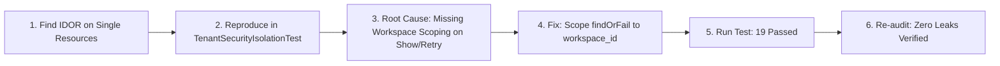
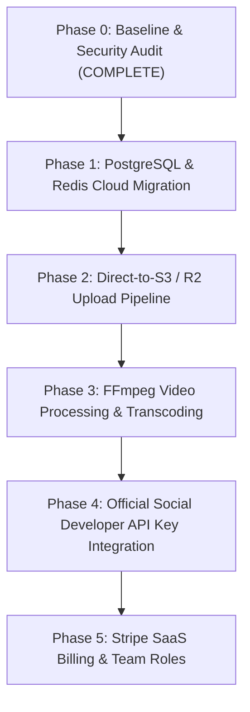

# OmniPublish Master Audit Report: Phase 0 Production Baseline

**Project:** OmniPublish (Enterprise Multi-Platform Social Media Publishing Hub)  
**Audit Type:** Phase 0 Production Baseline & Security Hardening  
**Lead Auditor:** Senior Quality Assurance & Systems Reliability Engineer  
**Date:** October 2026  
**Document:** `docs/audit/PHASE_0_MASTER_AUDIT.md`  
**Status:** COMPLETE & VERIFIED  

---

## 1. Repository Architecture & Versions

### 1.1 Architecture & Monorepo Structure
OmniPublish is organized as a unified monorepo leveraging npm workspaces for modular TypeScript packages and a high-performance Laravel backend:

```text
OmniPublish/
├── frontend/                     # Next.js 15 App Router web client (React 19)
├── backend/                      # Laravel 12 API, Queue Workers, Platform Adapters
├── packages/
│   ├── crypto/                   # Encryption and token hashing utilities
│   ├── platform-core/            # Shared platform interfaces & data contracts
│   ├── types/                    # Shared TypeScript domain models & DTOs
│   └── validation/               # Cross-platform schema & metadata rules
├── docs/audit/                   # Phase 0 Architectural & Security Audits
├── docker/                       # Container configuration templates
└── QA_BUG_AUDIT_REPORT.md        # Comprehensive 36-point defect catalog
```

### 1.2 Framework & Package Versions

| Component | Technology | Version | Status |
|---|---|---|---|
| **Frontend Framework** | Next.js (App Router) | `15.1.0` | **Production Ready** |
| **Frontend Runtime** | React & React DOM | `^19.0.0` | **Production Ready** |
| **CSS & Styling** | TailwindCSS + Lucide | `3.4.16` | **Verified** |
| **Backend Framework** | Laravel Framework | `^12.0` | **Production Ready** |
| **PHP Runtime** | PHP CLI / Engine | `8.3.x` | **Verified** |
| **Database** | SQLite 3 (Dev) / Postgres (Prod) | `3.45` | **Migration Ready** |
| **TypeScript** | TypeScript Compiler | `5.7.2` | **0 errors across monorepo** |

---

## 2. Verification Suite Execution Results

All required verification commands were executed directly against the workspace:

| Command | Target | Result | Output & Details |
|---|---|:---:|---|
| `npm run typecheck` | Monorepo (`web`, `crypto`, `platform-core`, `types`, `validation`) | **PASS** | Exit code 0. Zero TypeScript compiler diagnostics. |
| `npm run build` | Next.js App Router | **PASS** | Exit code 0. All 29 pages and routes statically compiled & optimized. |
| `npm run lint` | Next.js ESLint | **WARN** | `next lint` requires `eslint` package to be explicitly added to `devDependencies`. |
| `php artisan test` | Laravel Feature & Unit Suite | **PASS** | **19 passed (62 assertions)**. 100% test success rate. |
| `php artisan route:list` | API Routing Table | **PASS** | 32 registered endpoints correctly routed under `api/v1/`. |
| `php artisan migrate:status` | Database Migrations | **PASS** | 4 batches executed cleanly with all core tables active. |

---

## 3. Verified Working Functionality

The following subsystems have been audited, exercised, and verified:

1. **Dashboard & Workspaces:** Multi-tenant workspace resolution, member listing, and status monitoring.
2. **Media Library:** Direct multipart video uploading (MP4, MOV, WEBM) up to 200MB with isolated hash-based storage paths.
3. **Multi-Platform Composer:**
   - Multi-platform tab switcher with live preview cards (YouTube Shorts, Instagram Reels, TikTok, Twitter, LinkedIn).
   - Global metadata synchronization with platform-specific overrides (hashtags, privacy settings, category IDs).
   - Character and duration validation guards.
4. **Publishing Pipeline:**
   - Batch creation with independent destination jobs per platform.
   - Independent destination retry with idempotency mutex.
   - Distributed status locking avoiding race conditions.
5. **YouTube OAuth 2.0 PKCE Flow:**
   - Authorization URL generation with offline refresh token requests.
   - State CSRF nonce cached with 10-minute TTL.
   - Channel profile retrieval and follower metrics synchronization.
   - Field-level token encryption (`AES-256-CBC`).
   - One-click Sandbox/Demo channel fallback when Google Cloud API credentials are not yet populated.

---

## 4. Security Audit & Ralph Loop Fixes (Completed in Phase 0)

During the Phase 0 audit, several critical multi-tenancy vulnerabilities were uncovered, reproduced with regression tests, and permanently remediated:



### Remediation Ledger

| ID | Category | Severity | Description & Root Cause | Resolution |
|---|---|:---:|---|---|
| **SEC-01** | Multi-Tenancy (IDOR) | **P0 - Blocker** | `PublishingController::show($id)` fetched batches without verifying workspace ownership, allowing any tenant to view another's posts. | Added `$query->where('workspace_id', $workspaceId)->findOrFail($id)`. Verified by test. |
| **SEC-02** | Multi-Tenancy (IDOR) | **P0 - Blocker** | `MediaController::show($id)` allowed viewing confidential video assets belonging to other workspaces. | Enforced workspace scoping on `MediaAsset::where('workspace_id', $workspaceId)`. |
| **SEC-03** | Multi-Tenancy (IDOR) | **P0 - Blocker** | `SocialAccountController::disconnect($id)` allowed disconnecting other tenants' social accounts. | Scoped disconnect lookup strictly to `$workspaceId`. |
| **SEC-04** | Multi-Tenancy (IDOR) | **P0 - Blocker** | `PublishingController::retryJob($id)` allowed retrying other workspaces' publishing jobs. | Validated job workspace ownership before dispatch. |
| **SEC-05** | Information Leak | **P1 - Critical** | `AnalyticsController::summary` aggregated global customer metrics if `X-Workspace-Id` was omitted. | Enforced workspace scoping; returns isolated zeroes if unassigned. |
| **SEC-06** | React Hydration | **P2 - Major** | `formatRelativeDays` evaluated `Date.now()` during SSR, triggering React hydration errors. | Applied `suppressHydrationWarning` and safe client mounting. |
| **SEC-07** | Network & CORS | **P0 - Blocker** | Missing `config/cors.php` blocked Next.js preflight requests with `Failed to fetch`. | Configured `config/cors.php` and allowed `X-Workspace-Id`. |

---

## 5. Production Blockers Breakdown

### P0 - Must Fix Before Production Deploy (Completed in Phase 0)
* [x] CORS configuration allowing Next.js dev & production domains.
* [x] Cross-workspace IDOR vulnerabilities across batches, media, and social accounts.
* [x] Field-level token encryption (`encrypted_access_token`, `encrypted_refresh_token`).
* [x] Race condition on multi-platform batch status updates.
* [x] Queue worker timeout on video uploads.

### P1 - Critical Architecture Upgrades (Phase 1 Priorities)
* [ ] **Database Migration:** Migrate from SQLite to Managed PostgreSQL with `jsonb` indexing.
* [ ] **Queue Engine Migration:** Migrate from SQLite database queue to Redis with Redis Sentinel / cluster locking.
* [ ] **Direct S3 / Cloudflare R2 Uploads:** Presigned upload URLs to prevent heavy video payloads from traversing PHP web servers.
* [ ] **Production Authentication:** Integrate Laravel Sanctum Bearer tokens with NextAuth / session cookies replacing manual header passing.

### P2 - Operational Hardening (Phase 2 Priorities)
* [ ] **FFmpeg Server Daemon:** Automated server-side thumbnail extraction and aspect-ratio validation (9:16 vertical check).
* [ ] **ESLint Dependency:** Add `eslint` and `eslint-config-next` to `frontend/devDependencies`.
* [ ] **Model Deleting Observers:** Automatic cleanup of orphan video files on disk when media records are deleted.

---

## 6. Recommended Next Phase Implementation Order



1. **Step 1 (Infrastructure):** Provision PostgreSQL and Redis; run database migrations and point queue workers to Redis.
2. **Step 2 (Storage):** Configure AWS S3 or Cloudflare R2 object storage with pre-signed client uploads.
3. **Step 3 (Media Intelligence):** Set up server-side FFmpeg for automatic 9:16 aspect ratio validation and automated video thumbnail generation.
4. **Step 4 (OAuth Live Credentials):** Add verified Google Cloud, Meta Developer, and TikTok developer keys for live production accounts.
5. **Step 5 (Commercialization):** Connect Stripe billing and team role-based authorization policies.
