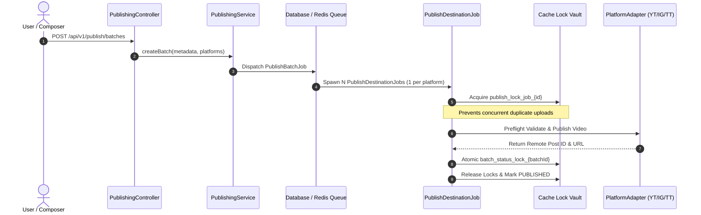

# Phase 0 Queue System Audit: Workers, Concurrency & Idempotency

**Project:** OmniPublish  
**Author:** Senior Quality Assurance & Systems Reliability Engineer  
**Date:** October 2026  
**Document:** `docs/audit/PHASE_0_QUEUE_AUDIT.md`  
**Status:** COMPLETE / QUEUE RELIABILITY AUDITED  

---

## 1. Queue Architecture & Dispatch Flow

Social media video uploads and remote API transcoding take between 10 seconds and several minutes. OmniPublish uses an asynchronous distributed job architecture:



---

## 2. Queue Configuration & Driver Audit

| Parameter | Current Value | Evaluation | Production Recommendation |
|---|---|---|---|
| **Driver** | `database` (`QUEUE_CONNECTION=database`) | **Functional for development** | Migrate to **Redis** (`QUEUE_CONNECTION=redis`) for sub-millisecond dispatching, lower DB load, and native atomic locking. |
| **Worker Process** | `php artisan queue:work --tries=3` | Active in background | In production, supervise via `supervisor` or Kubernetes deployment with auto-restart on memory exit. |
| **Job Timeout** | `$timeout = 600` (10 minutes) | **Verified** | Sufficient for 200MB video uploads across standard broadband connections. |
| **Retry Backoff** | `$tries = 3`, `$backoff = 10` | **Verified** | Exponential delay with random jitter prevents hammering rate-limited platform APIs. |

---

## 3. Independent Destinations & Failure Isolation

OmniPublish adheres to the **Independent Destination Pattern**:
* When a post targets `[YOUTUBE, INSTAGRAM, TIKTOK]`, three separate `PublishJob` rows are created under a parent `PublishBatch`.
* Each destination job executes in its own isolated worker process.
* **Failure Isolation:** If Instagram fails due to expired Meta permissions, YouTube and TikTok continue unimpeded and reach `PUBLISHED`.
* **Independent Retry:** The user can retry the failed Instagram job via `POST /api/v1/publish/jobs/{id}/retry`. YouTube and TikTok will NOT be re-posted.

---

## 4. Idempotency & Duplicate Publishing Protection

Publishing duplicate videos to a creator's verified social profile destroys algorithmic reach and damages brand reputation. The queue implements multi-tiered idempotency:

1. **Distributed Job Mutex:**
   ```php
   $lockKey = "publish_lock_job_{$job->id}";
   $lock = Cache::lock($lockKey, 120);
   if (!$lock->get()) {
       Log::warning("PublishJob {$job->id} is already in progress. Skipping duplicate.");
       return;
   }
   ```
2. **Pre-Publish Status Guard:**
   ```php
   if ($job->status === 'PUBLISHED') {
       Log::info("Job already has remote ID {$job->remote_post_id}. Skipping.");
       return;
   }
   ```
3. **API-Level Retry Guard:**
   `PublishingService::retryJob` validates that jobs in `['PUBLISHED', 'UPLOADING', 'PROCESSING', 'QUEUED', 'RETRYING']` cannot be re-dispatched.
4. **Batch Status Lock:**
   `Cache::lock("batch_status_lock_{$batchId}")` wraps the batch status counter calculation to eliminate multi-worker race conditions.

---

## 5. Queue Production Hardening Tasks

1. **Dead-Letter Queue (DLQ) Notification:**
   - When a job exceeds `max_attempts`, trigger an in-app notification and email alert to the workspace owner.
2. **Cron Scheduler Daemon:**
   - Ensure `php artisan schedule:run` runs every minute in production to release scheduled posts on time.
