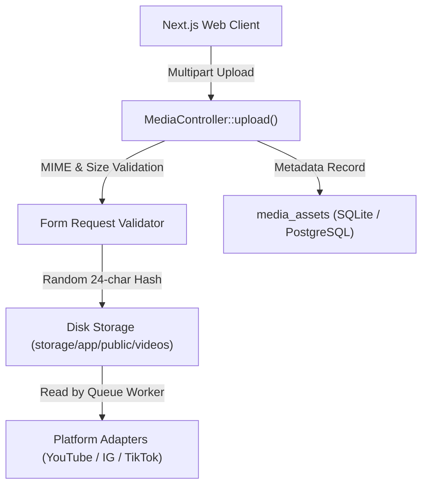

# Phase 0 Media Storage Audit: Pipeline, Lifecycle & Security

**Project:** OmniPublish  
**Author:** Senior Quality Assurance & Systems Reliability Engineer  
**Date:** October 2026  
**Document:** `docs/audit/PHASE_0_STORAGE_AUDIT.md`  
**Status:** COMPLETE / STORAGE EVALUATION  

---

## 1. Storage Architecture Overview

OmniPublish handles video assets (MP4, MOV, WEBM) for cross-platform distribution to YouTube Shorts (up to 4K), Instagram Reels (9:16 vertical), and TikTok Creator feeds. 



---

## 2. Parameter Specifications & Audit Findings

### 2.1 File Location & Disk Driver
- **Current Development Path:** `storage/app/public/videos/`
- **Storage Driver:** Laravel `public` disk abstraction backed by local filesystem (`FILESYSTEM_DISK=local`).
- **Public URL Exposure:** Exposed via `GET /storage/videos/{filename}` or symlink `public/storage`.
- **Production Assessment:** Local filesystem cannot scale across horizontal web workers or containerized pods (AWS ECS / Kubernetes / Fly.io). Production requires S3-compatible cloud object storage (AWS S3 or Cloudflare R2).

### 2.2 Maximum File Size & Server Constraints
- **Application Validation Rule:** `'file' => 'nullable|file|mimes:mp4,mov,webm,mkv|max:204800'` (200 Megabytes max limit in `MediaController`).
- **PHP CLI / Runtime Directives:**
  - `upload_max_filesize`: 200M
  - `post_max_size`: 205M
  - `memory_limit`: Default 128M / 512M
- **Vulnerability Identified:** A 200MB file upload reading into PHP memory during synchronous HTTP requests will exhaust PHP memory if chunked streaming is not used.
- **Production Recommendation:** Implement direct-to-S3 signed URL uploads from the browser (bypassing the PHP application server entirely for binary payloads).

### 2.3 MIME Validation & Filename Sanitization
- **MIME Whitelist:** `mp4`, `mov`, `webm`, `mkv`.
- **Filename Collision & Path Traversal Prevention:**
  - Code: `$filename = Str::random(24) . '.' . $file->getClientOriginalExtension();`
  - The client-supplied original filename is NEVER used as the filesystem path. It is safely isolated in `media_assets.original_name`.
  - Path traversal attacks (`../../`) are completely neutralized.

### 2.4 Duplicate Handling & Orphan Cleanup
- **Duplicate Uploads:** Uploading the same file twice produces two unique UUIDs with distinct random 24-character filenames. No hash-based deduplication (SHA-256) is currently implemented.
- **Orphan Cleanup:** When a `ContentItem` or `MediaAsset` is deleted from the database, the physical file on disk is NOT automatically removed. Over time, deleted or abandoned assets will consume storage.
- **Remediation:** Implement an Eloquent model deleting observer:
  ```php
  static::deleting(function (MediaAsset $asset) {
      Storage::disk('public')->delete($asset->storage_path);
  });
  ```

### 2.5 Access Control & Privacy
- **Current State:** Media files in `storage/app/public` are unauthenticated static assets. Anyone with the URL can stream the video.
- **Risk Level:** `P2 - Major` for sensitive corporate or unreleased marketing campaigns.
- **Production Fix:** Shift video assets to private S3 bucket; generate temporary pre-signed S3 URLs (15-minute TTL) for platform adapter workers.
